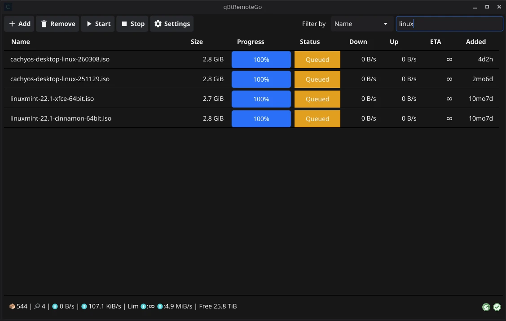
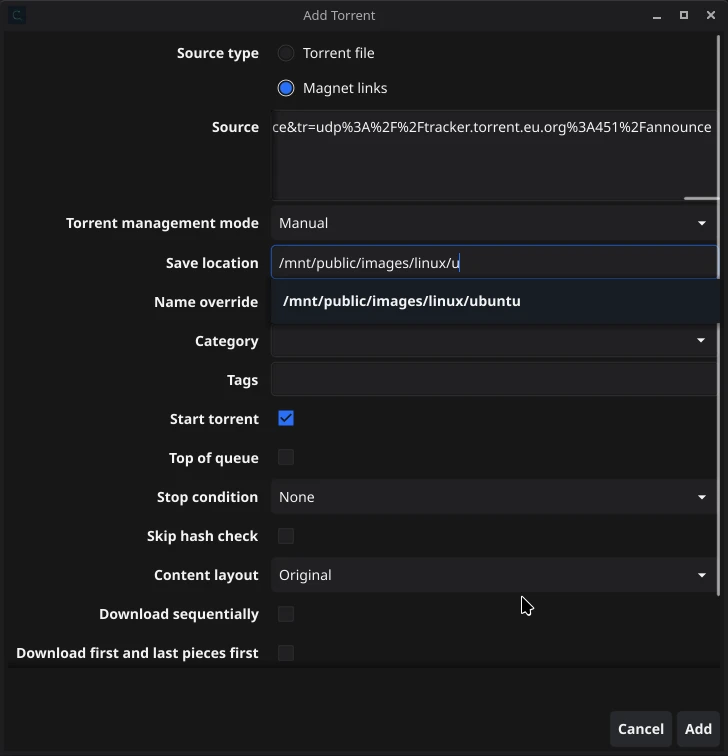

# qBtRemoteGo 

qBtRemoteGo is a native desktop client for remotely controlling qBittorrent through its Web API.

It focuses on a fast add-and-monitor workflow for magnets and `.torrent` files, with a compact GUI and desktop integration.

## Screenshots

Add torrent

## Installation

Check the [Releases](https://git.skobk.in/skobkin/qBtRemoteGo/releases) section for the latest downloads.

> [!NOTE]
> Releases are hosted on my private [Forgejo](https://en.wikipedia.org/wiki/Forgejo) instance.

## Connection & authentication

Two authentication methods, selected in *Settings → Connection* (API key is the default):

- **API key** — qBittorrent v5.2.0+; generate it in qBittorrent (*Preferences → WebUI → API Key*)
  and paste it here. Sent as `Authorization: Bearer`, so it can't be combined with reverse-proxy
  HTTP Basic Auth.
- **Username & password** (deprecated) — kept for older qBittorrent versions; prefer an API key.

The app never revokes or rotates the key server-side. Only the active method's credentials are
kept — switching methods means re-entering them. Passwords and keys are stored in the system
keychain (default), in the plain-text config file, or for the current session only.

### Host override (advanced)

*Settings → Connection → Advanced → Host override* connects to a different host or IP than the
one in the URL — useful when the URL host resolves publicly to another address, e.g.
`https://torrent.domain.tld` points at your public IP, but over VPN the same server lives at
`192.168.0.5` or `internal.domain.tld`.

- Accepts a host name, an IP (`192.168.0.5`, `[::1]`), or either with an explicit port
  (`internal.domain.tld:8080`). Without a port, the URL's port (including the scheme default,
  e.g. 443 for HTTPS) is kept.
- The URL host is still sent as the HTTP `Host` header and is used for the TLS server name and
  certificate validation, so reverse-proxy setups keep working. An internal server presenting a
  different certificate still needs *Skip certificate validation*.
- Applies to direct connections. If `HTTP_PROXY`/`HTTPS_PROXY` is set, exclude the host with
  `NO_PROXY` — the override does not apply to connections established through a proxy.

